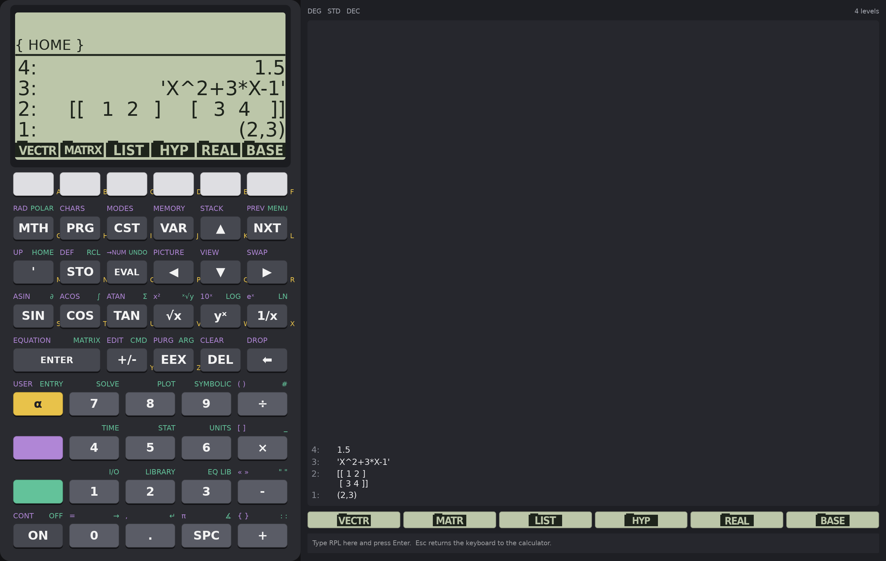
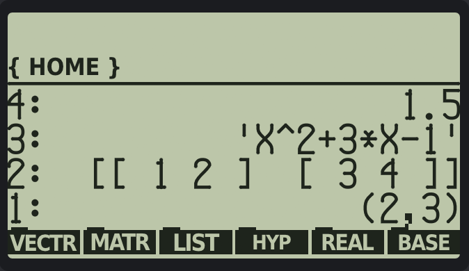
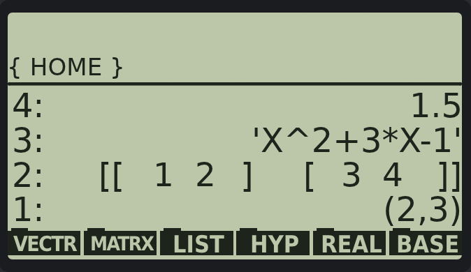
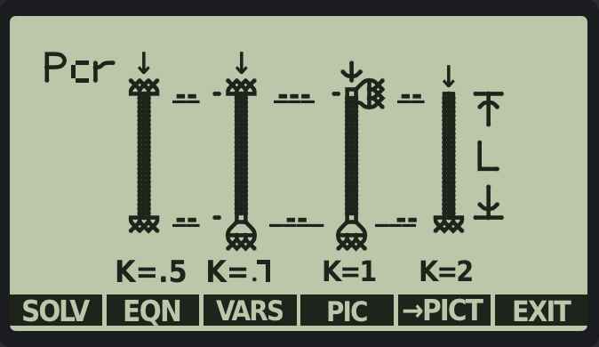
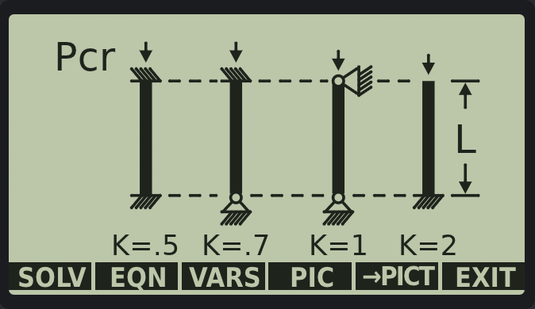
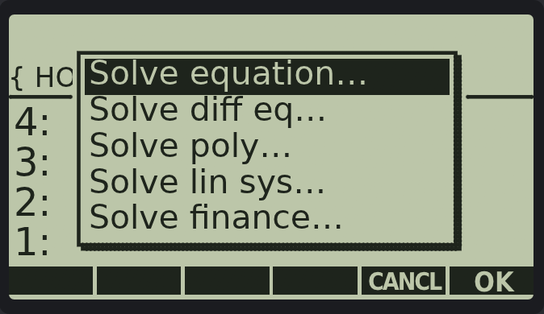

# HP 48GX: emulator and ROM source



This repository holds three things:

- **`firmware/`**: the complete HP 48GX ROM (revision R) as commented,
  editable assembler and RPL source. It builds to a ROM image that runs on the
  calculator's emulators. It is revision R plus a few changes of our own for
  the hi-res display (below). Nothing in it has moved, so programs written for
  the real calculator still run. Use it to study how the calculator works or to
  change it. Start with [`firmware/README.md`](firmware/README.md). The known
  bugs are in [`firmware/BUGS.md`](firmware/BUGS.md).
- **`crates/`**: an HP 48GX emulator in Rust. The desktop calculator adapts to
  its window. A narrow window shows the calculator alone. A wide one adds a
  panel with the stack as text, the menu keys as buttons and a command line
  typed on the computer's keyboard. Plots open in a resizable window. There is
  also a headless command-line runner.
- **`tools/`, `docs/`, `data/`**: the reverse-engineering tools that produced
  the source (an analyser, a disassembler and an assembler), and notes on the
  ROM's structure ([`docs/rom-map.md`](docs/rom-map.md)).

## The hi-res display

The real calculator has a 131×64-pixel LCD. The emulator adds a second,
high-resolution display over it, so the calculator's own screens are drawn as
sharp text and vector art at any window size, not as enlarged pixels.

| Original LCD | Hi-res display |
|---|---|
|  |  |
|  |  |



How it works:

- The ROM tells the display what it draws. The changed ROM
  (`ROM/gxrom-hires`) sends a command to the emulator as it draws: the text of a
  stack level, a menu label, the edit line, a message or a row of a Choose box,
  and where it goes. The emulator draws that text in a real font, on the same
  grid of character cells, so columns and the cursor still line up.
- It still draws on the LCD too. Programs that read the screen, such as
  `→PICT`, see what they always did. The hi-res display lives in the emulator,
  not in calculator memory.
- The LCD wins. A hi-res item shows only while the LCD under it still shows
  what it replaced. So clearing the screen, switching to another display, or a
  program writing straight to display memory hides it. External programs that
  know nothing about the hi-res display just show on the LCD, as they always did.
- Equation Library pictures are bitmaps in the ROM, with no drawing code to
  scale, so the emulator has vector art for them, matched to the bitmap. So
  far that is Elastic Buckling.
- Menu labels and the rows of a Choose box can be clicked with the mouse.

What isn't on the hi-res display yet is still drawn from the LCD, traced into
vector shapes: plots, input forms and the larger applications,
among others. The ROM's screens are being moved over one call at a time.

To turn the hi-res display off, use the LCD's context menu or `--no-hires`.
With `--rom ROM/gxrom-r` (the original ROM), everything is drawn from the LCD.

## Quick start

You need Rust 1.80 or later, and Python 3.10 or later to rebuild the firmware.

```
cargo run --release -p hp48-app                        # the calculator, on ROM/gxrom-hires
cargo run --release -p hp48-app -- --rom ROM/gxrom-r   # the original ROM
```

After changing `firmware/`, rebuild the image the emulator runs:

```
cd tools && python build.py -o ../ROM/gxrom-hires && cd ..
cargo run --release -p hp48 --example translate         # the translated ROM code follows the image
```

Then run the emulator's test suite and the Python tests:

```
cargo test --release --workspace
python -m unittest discover -s tests
```

The tests boot the ROM, calculate, compare plots with the ROM's own drawing,
and check that the changed ROM still behaves like revision R for external
programs.

The firmware is Hewlett-Packard's (Copyright HP 1993). HP has made the HP 48
ROM images freely available for use with emulators.
